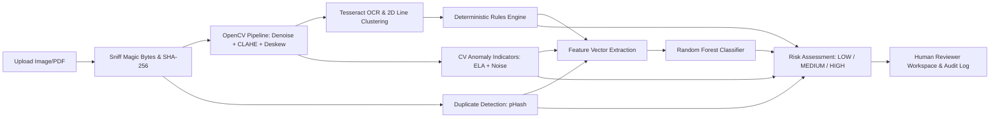

# FinVision: Intelligent Financial Document Verification

[](https://www.python.org/)
[](https://firebase.google.com/)
[](https://opensource.org/licenses/MIT)

**FinVision** is a Firebase-native AI/ML financial document verification and audit system designed for corporate accounting workflows, invoice anomaly detection, and straight-through processing compliance.

---

## 1. Core Architecture

FinVision uses **Firebase as the single system of record**:
- **Identity & Access**: Firebase Authentication (email/password) using Identity Toolkit REST API with custom token claims (`analyst` and `admin`).
- **Structured Database**: Cloud Firestore (Native mode) with strict server-enforced security rules preventing client manipulation of risk, ML, and review fields.
- **File Storage**: Cloud Storage for Firebase (`users/{uid}/invoices/{docId}/{filename}`) with MIME type sniffing and 10 MB limits.
- **Compute / Container**: Cloud Run container bundling Python 3.12, OpenCV headless, and Tesseract OCR.
- **Hosting**: Firebase Hosting with rewrites directing all traffic directly to Cloud Run.
- **Offline / Local Dev**: Configured with the Firebase Local Emulator Suite (Auth, Firestore, Storage, UI) for zero-billing local development, with an automatic in-memory fallback.

```
FinVision/
├── app.py                  # Streamlit entry + auth gate + router
├── frontend/               # UI components, dashboard, upload, verify, history, analytics, reports
│   ├── styles.css          # Linear/Stripe-inspired fintech theme
│   ├── components.py       # Reusable KPI cards and risk badges
│   ├── dashboard.py        # Executive portfolio KPI cards & Plotly charts
│   ├── upload.py           # Drag-and-drop ingestion & pipeline runner
│   ├── verify.py           # Document inspection, editable form & reviewer sign-off
│   ├── history.py          # Searchable portfolio archive
│   ├── analytics.py        # Rule failure frequencies & quality metrics
│   ├── reports.py          # ReportLab PDF audit generator
│   └── settings.py         # System tolerances & model registry
├── src/                    # Pure Python domain modules (zero Firebase imports)
│   ├── image_processing.py # Denoising, CLAHE, deskewing, ELA, noise inconsistency
│   ├── ocr.py              # Tesseract OCR, 2D line clustering & field extraction
│   ├── verification.py     # Pure arithmetic & business rule engine (Decimal math)
│   ├── duplicate_detection.py # SHA-256, perceptual pHash & semantic matching
│   ├── feature_extraction.py  # Tabular feature vector extraction for ML
│   ├── train_model.py      # Random Forest classifier with GroupShuffleSplit
│   ├── predict.py          # Model inference & confidence scoring
│   ├── risk_assessment.py  # Multi-criteria scoring & rule precedence engine
│   └── firebase_service.py # Single module interfacing with Firebase Admin SDK
├── config/                 # Rules tolerances & risk weights
├── dataset/                # Raw invoice dataset + SYNTHETIC_METHOD.md + manifest.csv
├── models/                 # Model serialization artifacts & version metadata
├── tests/                  # Complete pytest suite (47 tests)
├── firebase.json           # Firebase CLI & emulator configuration
├── firestore.rules         # Deny-by-default security rules
├── firestore.indexes.json  # Composite Firestore indexes
├── storage.rules           # Storage security rules
├── Dockerfile              # Cloud Run deployment container
└── requirements.txt        # Pinned dependencies
```

---

## 2. Key Capabilities & Pipeline



### A. Preprocessing Pipeline (`src/image_processing.py`)
- **PyMuPDF**: Multi-page PDF rasterization to 300 DPI.
- **Bilateral Filtering**: Preserves text edges while reducing sensor noise.
- **CLAHE**: Corrects uneven scan illumination.
- **Deskewing**: MinAreaRect contour angle estimation with a $\pm 45^{\circ}$ safety guard to avoid 90-degree over-rotation.
- **Adaptive Gaussian Thresholding**: High-contrast text binarization.

### B. OCR & Layout-Aware Field Extraction (`src/ocr.py`)
- Uses `pytesseract.image_to_data` for word-level bounding boxes and confidences.
- **2D Spatial Clustering**: Reconstructs multi-column reading order by grouping words sharing vertical baseline overlap ($>45\%$).
- Extracts invoice number, date, vendor, customer, line items, and financial totals.
- Maps word recognition confidences to per-field confidence scores ($0-100\%$).
- **Strict Honesty**: Never fabricates missing values; returns `None` for un-extracted fields.

### C. Deterministic Financial Rule Engine (`src/verification.py`)
- Strictly employs `Decimal` representation (never floats) to eliminate binary rounding errors:
  1. `RULE_LINE_ITEM_MATH`: $\text{quantity} \times \text{unitPrice} == \text{lineTotal}$
  2. `RULE_SUBTOTAL_SUM`: $\sum \text{lineTotals} == \text{subtotal}$
  3. `RULE_TAX_CALCULATION`: $\text{subtotal} \times \text{taxRate} == \text{tax}$
  4. `RULE_TOTAL_SUM`: $\text{subtotal} + \text{tax} == \text{total}$
  5. `RULE_REQUIRED_FIELDS`: Validates presence of mandatory fields.
  6. `RULE_DATE_SANITY`: Date is valid, not future-dated, and within 10 years.
  7. `RULE_NUMERIC_OUTLIER`: Robust z-score / IQR evaluation vs user transaction history.

### D. Explainable CV Anomaly Indicators
- **Error Level Analysis (ELA)**: Computes JPEG recompression residuals to highlight spliced digital patches.
- **Local Noise Variance Inconsistency**: Tiled $32 \times 32$ Laplacian variance analysis using median absolute deviation.
- **Text Layout Outliers**: Identifies spliced numbers through font-height deviations.
- **Copy-Move Matching**: ORB keypoint matching with spatial distance constraints.
- *Notice*: All CV outputs are explicitly designated as explainable heuristics requiring human review, not proof of tampering.

### E. Multi-Modal Duplicate Detection (`src/duplicate_detection.py`)
- **Exact**: SHA-256 byte identity.
- **Perceptual (Near-Exact)**: 64-bit DCT pHash Hamming distance $\le 5$ (resilient to re-compression and scanner contrast).
- **Semantic**: Matching normalized `(invoiceNumber, vendor)` or `(vendor, date, total)`.

### F. Honest Machine Learning Protocol (`src/train_model.py`)
- **No Fabricated Labels**: The raw dataset contains no fraud labels. Real invoices are treated as Normal (Label 0).
- **Synthetic Perturbations**: Generates documented Suspicious cases (Label 1) via total inflation, tax alterations, subtotal distortions, and field omissions.
- **Zero Leakage**: Strict `GroupShuffleSplit` on `source_invoice_id` ensures an invoice and its variants never straddle train and test splits.
- **Baseline Comparison**: Compared directly against deterministic rule baselines.

### G. Risk Assessment Engine (`src/risk_assessment.py`)
- Combines rules, duplicates, CV scores, and ML probabilities using weights in `config/risk_weights.json`.
- **Rules Precedence**: A critical rule failure forces `HIGH` risk regardless of ML confidence. ML can raise risk, but can never override a rule-based HIGH.
- **Ethical Language**: Never uses the word "fraud" or "fraudulent"; always outputs objective risk scores requiring human review.

---

## 3. Quick Start & Local Development

### 1. Prerequisites
- Python 3.12 (`.venv` virtual environment)
- Tesseract OCR (UB-Mannheim binary on Windows or system tesseract on Linux)
- Node.js & Firebase CLI (`firebase-tools`)

### 2. Setup Environment
```powershell
# Create and activate virtual environment
uv venv .venv --python 3.12
.\.venv\Scripts\activate

# Install dependencies
uv pip install -r requirements.txt
```

### 3. Run the Streamlit Application
```powershell
.\.venv\Scripts\streamlit.exe run app.py
```
Open `http://localhost:8501` in your browser. Click **⚡ Quick Demo Analyst Sign-In** for instant access!

### 4. Run the Firebase Local Emulator (Optional)
```powershell
firebase emulators:start
```
Emulator UI will be available at `http://127.0.0.1:4000`.

---

## 4. Test Suite

Run all automated unit tests across the entire codebase:
```powershell
.\.venv\Scripts\pytest.exe -v
```
All 47 tests pass covering rules, OCR, deskewing, ELA, noise analysis, duplicate detection, ML inference, PDF report generation, and security rules.

---

## 5. Cloud Deployment (Google Cloud Run + Firebase Hosting)

### Build and Deploy Container to Cloud Run:
```bash
# Build container image via Google Cloud Build
gcloud builds submit --tag gcr.io/finvision-dev/finvision:latest

# Deploy Cloud Run service
gcloud run deploy finvision \
    --image gcr.io/finvision-dev/finvision:latest \
    --platform managed \
    --region us-central1 \
    --allow-unauthenticated

# Deploy Firebase Hosting rewrites and Security Rules
firebase deploy --only hosting,firestore:rules,storage
```

